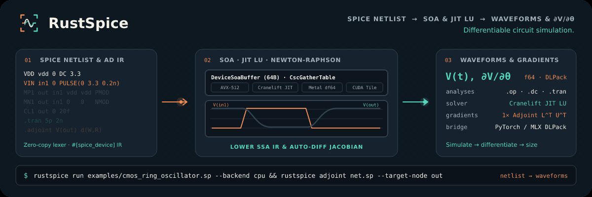

<p align="center">
  
</p>

<h1 align="center">Circuit simulation for the next design iteration.</h1>

<p align="center">
  <a href="https://lab-emi.github.io/RustEDA/modules/rustspice/">Documentation</a> ·
  <a href="https://github.com/lab-emi/RustEDA">RustEDA</a> ·
  <a href="https://lab-emi.github.io/RustEDA/benchmarks/">Benchmarks</a> ·
  <a href="LICENSE">Apache-2.0</a>
</p>

<picture>
  <source media="(prefers-reduced-motion: reduce)" srcset="docs/assets/rustspice-banner.svg">
  
</picture>

RustSpice simulates transistor-level SPICE netlists (`.op`, `.dc`, `.tran`) and computes discrete adjoint parameter sensitivities with Structure-of-Arrays (SoA) device evaluation, auto-differentiated model kernels and topology-specialized sparse linear solvers.

Part of **[RustEDA](https://github.com/lab-emi/RustEDA)**, infrastructure for chip-design recursive self-improvement. Native tools shorten the work between inference steps; verified results guide the next iteration.

## RustSpice vs ngspice at a glance

Ibex RTL-to-GDS on IHP SG13G2 with EZ130 cells and two SRAM macros, 2026-11-13: RustEDA and LibreLane 3.0.17 (OpenROAD, Yosys, KLayout, Magic, Netgen) ran one after the other on the same 4-vCPU host from the same prepared inputs, and the same signoff scripts checked both layouts. Every RustEDA engine was built with Rust 1.100.0, RustSpice at [`71875bf`](https://github.com/lab-emi/RustSpice/commit/71875bf9a8c937fb6ada641c45f52df67f0cfa30).

- **4.1–7.0× faster end to end than the faster ngspice-45 solver** on RC decks from the native SPEF of the final Ibex layout (10 decks, 173 to 5,614 unknowns), with **1.4–2.1× less peak memory**. Some RustSpice medians are flagged `noisy`, so these multiples hold within this session only.
- **All 10 cases pass accuracy**, and RustSpice is closer to the tightly converged reference than default-tolerance ngspice in every case on the nominal output grid; at each simulator's own output points it is closer in only 6 of 10, with default-tolerance ngspice closer on two single nets and both multi-net decks.
- RustSpice is not part of the timed flow; the RustEDA flow around it finishes **4.4× sooner end to end** than LibreLane (751.54 s against 3,283.05 s with both flows' foundry checks on the same schedule; 3.5× with every check run one after another).

LibreLane's layout fails the shared timing gate (112 maximum-capacitance and fanout violations at TT and SS) and its equivalence check does not complete, so the receipt keeps its own ratio fields null under its publication rule; the multiples here divide the recorded times. Stages are paired by phase, not as identical tasks. Against the three losses of 2026-11-05, in same-load runs: repair before global routing now takes 0.73× the time of LibreLane's two pre-route resizer steps (ranges do not overlap; 1.18× on 2026-11-05), OpenRCX on RustEDA's layout is level with its time on LibreLane's (1.00×, ranges overlap; 1.36× on 2026-11-05) and the latch-up check on RustEDA's layout takes 0.76× its time on LibreLane's (1.11× with the checker of that campaign). RustEDA is still not faster or not better everywhere: RustROAD's standalone extraction took 1.22× OpenRCX's time at 4 threads in the campaign and, after three changes since, is narrowly faster at 4 threads (0.85×, faster in all 30 runs of two A/Bs; the ranges are apart in one and overlap by 47 ms in the other) and still 1.52× slower at 2 ([third round](https://lab-emi.github.io/RustEDA/benchmarks/#rustroad-extraction-third-round-2026-11-14)); the timing gate is level (0.98×, ranges overlap) and its layout keeps less hold margin (TT 0.108 ns against 0.172 ns; both meet hold). RustSTA's peak memory at 4 threads, 11.8 % above OpenSTA's in the campaign, is 12.6 % below it since a change after the campaign ([details](https://lab-emi.github.io/RustEDA/benchmarks/#ruststa-peak-memory-and-rustroad-extraction-2026-11-13)). [All stages, gates and losses](https://lab-emi.github.io/RustEDA/benchmarks/#ibex-host-campaign-2026-11-13) · [Where RustEDA still loses or is at parity](https://lab-emi.github.io/RustEDA/benchmarks/#where-rusteda-still-loses-or-is-at-parity-2026-11-13)

## PULPissimo benchmark scope

RustEDA's [PULPissimo benchmark](https://lab-emi.github.io/RustEDA/benchmarks/pulpissimo/) is **synthesis-only** and does not time RustSpice. It compares the PULPissimo Ibex core with a bounded Yosys 0.70/ABC reference on SKY130 HD; no transistor-level netlist, RC network or simulation is part of that campaign. On SKY130 the full PULPissimo SoC still exceeds a 2 h synthesis budget with behavioral L2 memory; an IHP SG13G2 / EZ130 synthesis-only test with 80 official SRAM macros completes in 426 s. Neither is a physical signoff result. RustSpice's comparison remains the ngspice-45 RC work below.

## Latest development · 2026-11-13

The RustEDA Ibex host campaign of 2026-11-13 (IHP SG13G2 / EZ130 with two real
SRAMs, on a 4-vCPU Intel Xeon cloud host reporting 2.10 GHz, with 15.7 GiB RAM
and no swap) ran `rustspice bench-suite` with RustSpice 0.1.0 (commit
[`71875bf`](https://github.com/lab-emi/RustSpice/commit/71875bf9a8c937fb6ada641c45f52df67f0cfa30),
built with Rust 1.100.0 instead of 1.97.1) against ngspice-45, with the deck
builder and method of 2026-11-05. RustROAD's route changed since then (its
topology controls cut the routed DEF from about 192 thousand wire pieces to 160
thousand), so the decks differ from 2026-11-05's: the eight largest single nets
of the new final layout have 173–237 unknowns (7–10 sinks), and the two
multi-net decks have 10 nets with 1,836 unknowns and 40 nets with 5,614.
**The suite verdict is `PASS`: all 10 cases `pass` accuracy.** Read at the
nominal `k × tstep` output grid, RustSpice is closer to the tightly converged
ngspice reference than default-tolerance ngspice in 10 of 10 cases. At each
simulator's own output points (without the harness's linear resampling of
ngspice's waveform) it is closer in 6 of 10; default-tolerance ngspice is closer
on `ibex_net_00` (8.51 × 10⁻⁶ against 1.05 × 10⁻⁵), on `ibex_net_05`
(2.03 × 10⁻⁵ against 2.44 × 10⁻⁵) and on both multi-net decks (4.67 × 10⁻⁴
against 5.99 × 10⁻⁴ and 5.50 × 10⁻⁴). **RustSpice was 4.14–7.02× faster per
deck, end to end, than the faster ngspice solver (SPARSE in every case), and
used less memory in every case.**

| | 8 single nets | 10 nets, 1,836 unknowns | 40 nets, 5,614 unknowns |
| --- | ---: | ---: | ---: |
| Accuracy verdict | `pass` × 8 | `pass` | `pass` |
| Error / swing, RustSpice | 5.47 × 10⁻⁶ – 2.44 × 10⁻⁵ | 5.99 × 10⁻⁴ | 5.50 × 10⁻⁴ |
| Error / swing, default-tolerance ngspice, nominal grid | 2.57–8.23 × 10⁻⁵ | 1.59 × 10⁻³ | 1.59 × 10⁻³ |
| Error / swing, default-tolerance ngspice, its own output points | 7.12 × 10⁻⁶ – 2.03 × 10⁻⁵ | 4.67 × 10⁻⁴ | 4.67 × 10⁻⁴ |
| ngspice SPARSE, median per-deck wall | 194.77–256.92 ms | 298.95 ms | 1,158.88 ms |
| ngspice KLU, median per-deck wall | 222.27–307.41 ms | 348.62 ms | 1,234.75 ms |
| RustSpice, median per-deck wall | 37.86–53.33 ms | 46.94 ms | 165.03 ms |
| Quotient, faster ngspice ÷ RustSpice, per-deck wall (median) | 4.14–5.79× | 6.37× | 7.02× |
| Quotient, faster ngspice ÷ RustSpice, analysis time only (median) | 4.85–6.79× | 8.59× | 9.50× |
| Median peak RSS, ngspice SPARSE / RustSpice | 13,716–14,060 / 6,624–6,816 KiB | 19,000 / 11,040 KiB | 31,216 / 21,664 KiB |

Times are medians of seven interleaved repetitions after a correctness warm-up,
from one session on one host (load average 0.5 at the start and 1.0 at the
end). The suite flags the RustSpice medians of `ibex_net_03`, `ibex_net_04`,
`ibex_net_05`, `ibex_net_07` and `ibex_bulk_10` as `noisy` (relative spread
above 0.2), so the quotients hold within this session only. The analysis-only
quotient pairs ngspice's `Total analysis time` with RustSpice's `analysis_us`,
which excludes RustSpice's parse and compile. Process start-up medians are
6.53 ms for ngspice and 2.33 ms for RustSpice. The scope is unchanged: linear
RC interconnect only, no transistor-level Ibex simulation (RustSpice does not
implement IHP's PSP103 models), and RustSpice is not part of the timed
RTL-to-GDS flow.

**Against 2026-11-05 (history, not a before/after).** The 2026-11-05 campaign
measured RustSpice at 4.32–5.96× end to end on other decks (198–291, 2,262 and
6,865 unknowns) and on another virtual machine (a Xeon reporting 2.80 GHz). Both
changed: on this host ngspice's start-up alone took 6.53 ms against 12.35 ms
then, and RustSpice's 2.33 ms against 4.20 ms, and with the same tools and
inputs every LibreLane stage took less time (floorplan level). The two
campaigns' numbers therefore do not measure a change in RustSpice; compare
RustSpice with ngspice within each campaign.

[Decks, all values and method](docs/development-status.md#ibex-host-campaign-2026-11-13) ·
[SPICE head-to-head](https://lab-emi.github.io/RustEDA/benchmarks/#rustspice-vs-ngspice-45-2026-11-13) ·
[Host campaign 2026-11-13](https://lab-emi.github.io/RustEDA/benchmarks/#ibex-host-campaign-2026-11-13) ·
[Method and deviations](https://lab-emi.github.io/RustEDA/benchmarks/#host-campaign-method-and-deviations-2026-11-13)

## Ibex host campaign · 2026-11-05

The RustEDA Ibex host campaign of 2026-11-05 (IHP SG13G2 / EZ130 with two real
SRAMs, on a 4-vCPU Intel Xeon cloud host with 15.7 GiB RAM and no swap) ran
`rustspice bench-suite` with RustSpice 0.1.0 (commit
[`d4d6a50`](https://github.com/lab-emi/RustSpice/commit/d4d6a5043af226643d39ecc43f9a3859e29b0cc5)) against ngspice-45, with the deck builder and method of
2026-11-02. The decks come from the native nominal SPEF of the new final layout,
whose largest nets are smaller: the eight largest single nets have 198–291
unknowns (5–10 sinks), and the two multi-net decks have 10 nets with 2,262
unknowns and 40 nets with 6,865, so they are not the decks of 2026-11-02.
**All 10 cases `pass` accuracy.** Read at the nominal `k × tstep` output grid,
RustSpice is closer to the tightly converged ngspice reference than
default-tolerance ngspice in every case; at each simulator's own output points
(without the harness's linear resampling of ngspice's waveform) it is closer in
9 of 10 cases, ngspice on `ibex_net_01` (1.03 × 10⁻⁵ against 1.33 × 10⁻⁵), and
the multi-net decks are near level (4.50 × 10⁻⁴ against 4.83 × 10⁻⁴).
**RustSpice was 4.32–5.96× faster end to end than the faster ngspice solver,
and used less memory in every case.**

| | 8 single nets | 10 nets, 2,262 unknowns | 40 nets, 6,865 unknowns |
| --- | ---: | ---: | ---: |
| Accuracy verdict | `pass` × 8 | `pass` | `pass` |
| Error / swing, RustSpice | 4.67 × 10⁻⁶ – 1.33 × 10⁻⁵ | 4.50 × 10⁻⁴ | 4.50 × 10⁻⁴ |
| Error / swing, default-tolerance ngspice, nominal grid | 2.09–6.26 × 10⁻⁵ | 1.44 × 10⁻³ | 1.44 × 10⁻³ |
| Error / swing, default-tolerance ngspice, its own output points | 6.68 × 10⁻⁶ – 1.61 × 10⁻⁵ | 4.83 × 10⁻⁴ | 4.83 × 10⁻⁴ |
| Median end to end, faster ngspice solver | 287.99–419.83 ms | 434.57 ms (SPARSE) | 1,688.21 ms (KLU) |
| Median end to end, RustSpice | 57.17–90.02 ms | 86.22 ms | 283.11 ms |
| End-to-end speedup vs the faster ngspice solver | 4.32–5.45× | 5.04× | 5.96× |
| Solve-only speedup vs the faster ngspice solver | 5.07–6.36× | 6.39× | 7.72× |
| Median peak RSS, ngspice SPARSE / RustSpice | 13,872–14,324 / 6,828–7,208 KiB | 20,488 / 12,380 KiB | 34,968 / 24,552 KiB |

Times are medians of seven interleaved repetitions after a correctness warm-up,
from one session on one host (load average 0.6 at the start and 1.0 at the
end); the suite flags some RustSpice medians as `noisy` (spread above 20 %).
The faster ngspice solver was SPARSE except for the 40-net deck and one single
net (KLU). The scope is unchanged: linear RC interconnect only, no
transistor-level Ibex simulation (RustSpice does not implement IHP's PSP103
models), and RustSpice is not part of the timed RTL-to-GDS flow.

[SPICE head-to-head](https://lab-emi.github.io/RustEDA/benchmarks/#rustspice-vs-ngspice-45-2026-11-05) ·
[Host campaign 2026-11-05](https://lab-emi.github.io/RustEDA/benchmarks/#ibex-host-campaign-2026-11-05)

## Ibex host campaign · 2026-11-02

The RustEDA Ibex host campaign (IHP SG13G2 / EZ130 with two real SRAMs, on a
4-vCPU Intel Xeon cloud host with 15.7 GiB RAM and no swap) ran
`rustspice bench-suite` with RustSpice 0.1.0 (commit
[`cc2426f`](https://github.com/lab-emi/RustSpice/commit/cc2426f3e6cbb1ad05843b22a71632f118f62ddc))
against ngspice-45. The transient decks are linear RC networks from the native
nominal SPEF of the final RustEDA Ibex layout: the eight largest single nets
(548–649 unknowns, 3–10 sinks) and two multi-net decks (10 nets with 5,843
unknowns, 40 nets with 20,023). Each deck drives real nets with a Thevenin ramp,
keeps the extracted resistors and positive capacitors with coupling capacitance
grounded, and adds a fixed load capacitance at each sink pin. Accuracy is
checked at the probed nodes only: the driver and first sink of each single net
(2 probes), and of the first 4 nets in each multi-net deck (8 probes).
**All 10 cases `pass` accuracy**: against a tightly converged ngspice
reference, RustSpice's worst error / swing is 7.90 × 10⁻⁴, 39 % of the
tolerance of 2 × 10⁻³ set in each deck. **RustSpice was 3.68–5.78× faster end
to end than the faster ngspice solver**, which was SPARSE in every case.

| | 8 single nets | 10 nets, 5,843 unknowns | 40 nets, 20,023 unknowns |
| --- | ---: | ---: | ---: |
| Accuracy verdict | `pass` × 8 | `pass` | `pass` |
| Error / swing, RustSpice | 0.90–2.12 × 10⁻⁴ | 7.90 × 10⁻⁴ | 7.68 × 10⁻⁴ |
| Median end to end, ngspice SPARSE | 534.33–618.43 ms | 1,107.13 ms | 4,072.28 ms |
| Median end to end, RustSpice | 136.28–161.45 ms | 196.78 ms | 704.24 ms |
| End-to-end speedup vs the faster ngspice solver | 3.68–4.18× | 5.63× | 5.78× |
| Solve-only speedup vs the faster ngspice solver | 4.60–5.14× | 7.74× | 7.82× |
| Median peak RSS, ngspice SPARSE / RustSpice | 15,404–15,708 / 33,728–38,416 KiB | 30,724 / 46,232 KiB | 71,608 / 144,152 KiB |

Times are medians of seven interleaved repetitions after a correctness warm-up,
from one session on one shared host. Solve-only pairs ngspice's `Total analysis
time` with RustSpice's `analysis_us`, which excludes RustSpice's parse and
compile; end to end includes both. RustSpice used more memory than ngspice in
every case. The scope is linear RC interconnect only: RustSpice does not
implement the PSP103 models of the IHP SG13G2 transistors, so no
transistor-level Ibex simulation was run, and RustSpice is not part of the
timed RTL-to-GDS flow. This host's ngspice is ngspice-45; the differential
suite and the benchmark method below cite ngspice-47.

The measured source is the 2026-11-01 update, which includes adaptive transient
integration and breakpoint handling, strict SPICE parsing with
expressions/includes and explicit resource limits, extended diode/level-1 MOS
and controlled-source coverage, and adjoint parameter sensitivities. Batched
FP64 DC has a deterministic CPU reference and an optional CUDA kernel with
explicit fallback for unsupported/nonconverged cases.

[Current source and qualification](docs/development-status.md) ·
[SPICE head-to-head](https://lab-emi.github.io/RustEDA/benchmarks/#rustspice-vs-ngspice-45) ·
[Host campaign method and deviations](https://lab-emi.github.io/RustEDA/benchmarks/#host-campaign-method-and-deviations) ·
[All benchmarks](https://lab-emi.github.io/RustEDA/benchmarks/)

## Benchmarks

RustEDA publishes its benchmarks on one page: Ibex RTL-to-GDS on IHP SG13G2 / EZ130 against LibreLane, with module head-to-heads. See the [RustEDA benchmarks](https://lab-emi.github.io/RustEDA/benchmarks/). RustSpice's published performance comparisons are the head-to-heads with ngspice-45 from the [2026-11-13](https://lab-emi.github.io/RustEDA/benchmarks/#rustspice-vs-ngspice-45-2026-11-13) (the latest), [2026-11-05](https://lab-emi.github.io/RustEDA/benchmarks/#rustspice-vs-ngspice-45-2026-11-05) and [2026-11-02](https://lab-emi.github.io/RustEDA/benchmarks/#rustspice-vs-ngspice-45) Ibex host campaigns, on linear RC networks extracted from the Ibex layouts (summarized above); they cover no transistor-level circuit and apply to those hosts only. The [benchmark method](docs/benchmark_report.md) describes how to measure RustSpice against `ngspice` on your own host.

## Differential verification against ngspice

`rustspice bench-suite` runs 951 cases against ngspice-47 as a black-box executable: **857 pass**, **16 documented RustSpice gaps**, **77 informational**, **1 unverified** and **0 failing**, plus 400/400 random fuzz decks passing and 200/200 hostile mutants handled without a panic. See [`benchmarks/README.md`](benchmarks/README.md).

**Batched DC operating points on an NVIDIA GPU** (`rustspice bench-batch`, [method](docs/gpu_batch_report.md)): one circuit at many corners, one corner per CUDA thread in FP64, with a Newton / LU kernel written in Rust and compiled to PTX by [cuda-oxide](https://github.com/NVIDIA/cuda-rust); the same source, built for the CPU with rayon, is the reference it is tested against. The kernel covers plain diodes and level-1 MOSFETs with their bulk junctions. A corner the kernel does not converge is re-solved by the CPU solver. In the last recorded run, the GPU agreed with the CPU build to `5.6e-16` (bit for bit on the MOSFET circuits) and with the CPU solver to `1.8e-9` (relative, inside its Newton tolerance), and no corner needed a CPU re-solve. Creating the CUDA context and JIT-compiling the PTX is a one-time cost per process, so small batches can run faster on the CPU. MOS levels above 1, diodes with breakdown, series resistance or a knee current, polynomial sources, `.nodeset` and linear circuits still run on the CPU.

## Simulator features

- **Three-tier adaptive sparse linear solver (`rustspice-solver::linear`)**: combines symmetric minimum-degree ordering, diagonal-preferring threshold Markowitz pivoting (`0.1`) and factor-growth monitoring on the unrolled symbolic / Cranelift JIT tier with cached symbolic-once `faer` sparse LU (`FaerLuCache`), dense partial-pivoting LU for small ill-conditioned topologies, and Jacobi-preconditioned conjugate gradient (PCG).
- **Conflict-free static gather table (`CscGatherTable`)**: pre-stamps linear conductances once during compilation and gathers only active dynamic/nonlinear entries via contiguous offsets with zero atomic contention or binary search.
- **Adaptive LTE transient integration, quantized LU caching & homotopy (`rustspice-solver`)**: controls step size via divided-difference local truncation error (LTE), lands exactly on waveform breakpoints (`PULSE`, `SIN`, `EXP`, `PWL`) with L-stable `BE -> BE -> BDF-2 -> Trapezoidal` restarts sharing companion scaling (`w = phi`) across a quantized `hmax / 2^k` `FactorCache`, supports `.ic`, `uic`, `tstart`, `tmax`, `.nodeset`, and extended `.dc` sweeps (source, resistor, temperature, 2-variable nested), and pairs `pnjlim`/`fetlim` step-delta checks with adaptive `Gmin` and source-stepping homotopy.
- **Strict SPICE reader, expression/include engine & resource budgets (`rustspice-core`)**: resolves `.param` expressions, `.func` definitions, `.subckt ... PARAMS:` overrides, `.include`/`.lib` sections, and `.temp`/`.options` temperature scaling (`m=`, `tc1=`, `tc2=`), refuses unsupported directives or model levels via structured `Diagnostic` errors/warnings, and enforces configurable `ResourceLimits` (`--max-elements`, `--max-nodes`, `--max-subckt-depth`, `--max-sweep-points`, `--max-tran-steps`, `--max-newton-iters`).
- **Device and element coverage (`rustspice-core::ext`)**: diodes with series resistance, breakdown (BV/IBV), high injection (IKF), recombination current (ISR/NR), transit time and graded depletion capacitance; level-1 MOSFETs with process-derived KP/VTO/GAMMA/PHI (TOX, UO, NSUB, NSS, TPG), LD, RD/RS/RSH, bulk junctions and Meyer gate capacitances; E/F/H controlled sources, `POLY(1)` E/G sources, coupled inductors (K) and semiconductor `.model R`/`.model C`. BJT, JFET, MESFET, B, S, W, T, O, U and MOS LEVEL > 1 are refused with an error.
- **Discrete adjoint sensitivity (`AdjointSensitivityEngine`)**: computes exact gradients with respect to `P` parameters in a single transposed solve (`J^T λ = ∂L/∂V`) rather than `2P` perturbed simulations.

[Benchmark method](docs/benchmark_report.md) · [Architecture guide](docs/architecture.md).

## Quick start

Install [Rust with rustup](https://rustup.rs) and Git. The repository pins Rust 1.100.0. The CPU flow needs no GPU or external solver libraries. Run these commands in one POSIX shell:

```sh
git clone https://github.com/lab-emi/RustSpice.git
cd RustSpice
cargo build --release --locked -p rustspice-cli

# 1. Run DC operating point and transient simulation on a 5-stage CMOS inverter chain
./target/release/rustspice run examples/cmos_ring_oscillator.sp --backend cpu

# 2. Compute discrete adjoint parameter sensitivities dV(out)/d(theta)
./target/release/rustspice adjoint examples/cmos_ring_oscillator.sp --target-node out

# 3. Emit auto-differentiated, CSE-optimized device kernel code (msl, wgsl, cuda-tile, cuda-ptx, rust)
./target/release/rustspice codegen --model mosfet-ekv --target msl

# 4. Run the head-to-head accuracy and speed benchmark suite against local ngspice
./target/release/rustspice bench-ngspice --output target/bench-ngspice.md
```

## Built for CLI, heterogeneous compute and AI4EDA workflows

| Command / Interface | Purpose |
| :--- | :--- |
| `rustspice run <netlist> --backend <backend>` | Execute `.op`, `.dc`, and `.tran` analyses on `cpu`, `metal`, `cuda-tile`, `cuda-simt`, or `wasm` |
| `rustspice adjoint <netlist> --target-node <node>` | Compute exact gradients `∂V(node)/∂θ` across all circuit parameters in one transposed LU solve |
| `rustspice codegen --model <m> --target <t>` | Lower symbolic SSA device equations into optimized `Rust`, `MSL (df64)`, `WGSL (df64)`, `CUDA Tile`, or `CUDA PTX` kernels |
| `rustspice bench-ngspice --output <path>` | Run black-box accuracy and wall-time benchmarks against an external `ngspice` executable |
| `rustspice bench-batch --output <path>` | Time batched DC operating points on the CPU batch API, the batch kernel's CPU build and an NVIDIA GPU |
| `rustspice run <netlist> --internal-points` | Also write the accepted internal time steps between the `k * tstep` rows of a transient rawfile |
| `rustspice_py.PySimulator` (`DLPack`) | Zero-copy `DLManagedTensor` gradient and waveform export into `PyTorch` and Apple `MLX` (`examples/ai4eda_opamp_sizing.py`) |

## Compiler-driven simulation architecture

- **Single physics equation frontend (`#[spice_device]` & `rustspice-ir`)**: author forward device equations `I(V, θ)` and `Q(V, θ)` once; forward-mode and reverse-mode automatic differentiation synthesize analytical Jacobians (`∂I/∂V`, `∂Q/∂V`) and parameter pullbacks (`∂I/∂θ`), followed by constant folding, algebraic simplification, common subexpression elimination (CSE), and dead code elimination (DCE).
- **64-byte aligned SoA & zero-allocation hot loops (`rustspice-core`)**: device instances are packed into cache-aligned `DeviceSoaBuffer` arrays with pre-allocated state vectors and static `CscGatherTable` mappings. Zero heap allocations occur during DC sweeps, Newton-Raphson iterations, or transient stepping.
- **Multi-regime linear and nonlinear solvers (`rustspice-solver`)**: selects automatically between Cranelift JIT unrolled sparse LU, static-pivot symbolic-once LU with factorization caching, `faer` supernodal LU, and preconditioned conjugate gradient (PCG), guarded by `pnjlim`/`fetlim` damping and `Gmin`/source stepping homotopy.
- **Heterogeneous execution backends**:
  - **CPU (`rustspice-backend-cpu`)**: `pulp` runtime SIMD (`AVX-512` / `AVX2` / `NEON`), `rayon` parallel PVT batching, and `Cranelift` native machine-code JIT.
  - **Apple Silicon Metal (`rustspice-backend-metal`)**: unified memory (`MTLResourceStorageModeShared`) zero-copy buffers with `fma`-accelerated `df64` (`float2`) shaders and `f64` iterative refinement.
  - **NVIDIA CUDA dual-track (`rustspice-backend-cuda-tile` & `rustspice-backend-cuda-simt`)**: tile-based SoA batch evaluation, PTX SIMT gather-stamping + PCG, and batched FP64 DC operating points (one corner per CUDA thread) whose kernel is written in Rust, compiled to PTX by [cuda-oxide](https://github.com/NVIDIA/cuda-rust) and differentially tested against its own rayon `cpu_ref` build. The CUDA driver is loaded at run time, so the build needs no CUDA toolkit.
  - **WebAssembly & WebGPU (`rustspice-backend-wasm`)**: hybrid WASM `simd128` and WGSL `df64` compute pipeline.

## Documentation

The [documentation site](https://lab-emi.github.io/RustEDA/modules/rustspice/) integrates into the unified RustEDA documentation. All source pages also live in this repository.

| Start here | Go deeper |
| :--- | :--- |
| [Documentation home](https://lab-emi.github.io/RustEDA/modules/rustspice/) | [Architecture and crate boundaries](docs/architecture.md) |
| [Benchmark method vs. ngspice-47](docs/benchmark_report.md) | [AI4EDA differentiable sizing example](examples/ai4eda_opamp_sizing.py) |
| [CMOS ring oscillator deck](examples/cmos_ring_oscillator.sp) | [RustEDA documentation](https://lab-emi.github.io/RustEDA/) |

## Development and contributing

RustSpice is clean-room Rust. Reference simulators (`ngspice`) interoperate strictly as black-box external executables over standard SPICE netlists in differential accuracy and performance harnesses.

```sh
CARGO_BUILD_JOBS=2 RUST_TEST_THREADS=2 cargo test --workspace --locked
```

Licensed under [Apache-2.0](LICENSE).
