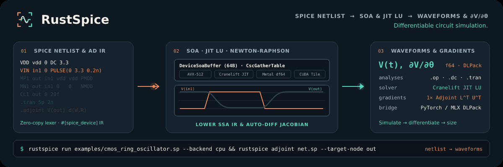

# RustSpice

RustSpice simulates transistor-level SPICE netlists (`.op`, `.dc`, `.tran`) and computes discrete adjoint parameter sensitivities with Structure-of-Arrays (SoA) device evaluation, auto-differentiated model kernels and topology-specialized sparse linear solvers.

[All RustEDA modules](https://lab-emi.github.io/RustEDA/)

<picture>
  <source media="(prefers-reduced-motion: reduce)" srcset="assets/rustspice-banner.svg">
  
</picture>

## RustSpice vs ngspice at a glance

Ibex RTL-to-GDS on IHP SG13G2 with EZ130 cells and two SRAM macros, 2026-11-05: RustEDA and LibreLane 3.0.17 (OpenROAD, Yosys, KLayout, Magic, Netgen) ran one after the other on the same 4-vCPU host from the same prepared inputs, and the same signoff scripts checked both layouts.

- **4.3–6.0× faster end to end than the faster ngspice-45 solver** on RC decks from the native SPEF of the final Ibex layout (10 decks, 198 to 6,865 unknowns), with **1.4–2.0× less peak memory**.
- **All 10 cases pass accuracy**, and RustSpice is closer to the tightly converged reference than default-tolerance ngspice in every case on the nominal output grid (9 of 10 at each simulator's own output points).
- The RustEDA flow around it finishes **4.2× sooner end to end** than LibreLane.

LibreLane's layout fails the shared timing gate (112 maximum-capacitance and fanout violations at TT and SS) and its equivalence check does not complete, so the receipt keeps its own ratio fields null under its publication rule; the multiples here divide the recorded times. Stages are paired by phase, not as identical tasks. RustEDA is not faster everywhere: its repair before global routing takes 1.18× LibreLane's two pre-route resizer steps alone, OpenRCX runs 1.36× longer on RustEDA's DEF, and the latch-up check 1.11× longer on its layout. [All stages, gates and losses](https://lab-emi.github.io/RustEDA/benchmarks/)

## PULPissimo benchmark scope

The [PULPissimo benchmark](https://lab-emi.github.io/RustEDA/benchmarks/pulpissimo/) is synthesis-only and does not time RustSpice. It compares the PULPissimo Ibex core with a bounded Yosys 0.70/ABC reference on SKY130 HD; no transistor-level netlist, RC network or simulation is part of it. On SKY130 the full PULPissimo SoC still exceeds a 2 h synthesis budget with behavioral L2 memory; an IHP SG13G2 / EZ130 synthesis-only test with 80 official SRAM macros completes in 426 s. Neither is a physical signoff result.

## Ibex host campaign · 2026-11-05

The RustEDA Ibex host campaign of 2026-11-05 (IHP SG13G2 / EZ130 with two real
SRAMs, on a 4-vCPU Intel Xeon cloud host with 15.7 GiB RAM and no swap) ran
`rustspice bench-suite` with RustSpice 0.1.0 (commit
[`d4d6a50`](https://github.com/lab-emi/RustSpice/commit/d4d6a5043af226643d39ecc43f9a3859e29b0cc5)) against ngspice-45, with the deck builder and method of
2026-11-02. The decks come from the native nominal SPEF of the new final layout,
whose largest nets are smaller: the eight largest single nets have 198–291
unknowns (5–10 sinks), and the two multi-net decks have 10 nets with 2,262
unknowns and 40 nets with 6,865, so they are not the decks of 2026-11-02.
**All 10 cases `pass` accuracy.** Read at the nominal `k × tstep` output grid,
RustSpice is closer to the tightly converged ngspice reference than
default-tolerance ngspice in every case; at each simulator's own output points
(without the harness's linear resampling of ngspice's waveform) it is closer in
9 of 10 cases, ngspice on `ibex_net_01` (1.03 × 10⁻⁵ against 1.33 × 10⁻⁵), and
the multi-net decks are near level (4.50 × 10⁻⁴ against 4.83 × 10⁻⁴).
**RustSpice was 4.32–5.96× faster end to end than the faster ngspice solver,
and used less memory in every case.**

| | 8 single nets | 10 nets, 2,262 unknowns | 40 nets, 6,865 unknowns |
| --- | ---: | ---: | ---: |
| Accuracy verdict | `pass` × 8 | `pass` | `pass` |
| Error / swing, RustSpice | 4.67 × 10⁻⁶ – 1.33 × 10⁻⁵ | 4.50 × 10⁻⁴ | 4.50 × 10⁻⁴ |
| Error / swing, default-tolerance ngspice, nominal grid | 2.09–6.26 × 10⁻⁵ | 1.44 × 10⁻³ | 1.44 × 10⁻³ |
| Error / swing, default-tolerance ngspice, its own output points | 6.68 × 10⁻⁶ – 1.61 × 10⁻⁵ | 4.83 × 10⁻⁴ | 4.83 × 10⁻⁴ |
| Median end to end, faster ngspice solver | 287.99–419.83 ms | 434.57 ms (SPARSE) | 1,688.21 ms (KLU) |
| Median end to end, RustSpice | 57.17–90.02 ms | 86.22 ms | 283.11 ms |
| End-to-end speedup vs the faster ngspice solver | 4.32–5.45× | 5.04× | 5.96× |
| Solve-only speedup vs the faster ngspice solver | 5.07–6.36× | 6.39× | 7.72× |
| Median peak RSS, ngspice SPARSE / RustSpice | 13,872–14,324 / 6,828–7,208 KiB | 20,488 / 12,380 KiB | 34,968 / 24,552 KiB |

Times are medians of seven interleaved repetitions after a correctness warm-up
on one host. The scope is linear RC interconnect only.

[Decks, all values and method](development-status.md) ·
[SPICE head-to-head](https://lab-emi.github.io/RustEDA/benchmarks/#rustspice-vs-ngspice-45-2026-11-05)

## Ibex host campaign · 2026-11-02

In the RustEDA Ibex host campaign (IHP SG13G2 / EZ130 with two real SRAMs, on a
4-vCPU cloud host), `rustspice bench-suite` compared RustSpice 0.1.0 with
ngspice-45 on transient decks built from linear RC networks of the final Ibex
layout: eight single nets (548–649 unknowns) and two multi-net decks (10 nets
with 5,843 unknowns, 40 nets with 20,023), each driven by a Thevenin ramp with
coupling capacitance grounded and a fixed load capacitance at each sink pin.
Accuracy is checked at 2 probed nodes per single net and at 8 (on the first 4
nets) per multi-net deck. **All 10 cases `pass` accuracy** against a
tightly converged ngspice reference (worst RustSpice error / swing
7.90 × 10⁻⁴, tolerance 2 × 10⁻³). **RustSpice was 3.68–4.18× faster end to end
than the faster ngspice solver on the single nets and 5.63× and 5.78× on the
multi-net decks**; solve-only speedups are 4.60–5.14×, 7.74× and 7.82×. Its
median peak RSS was higher: 33,728–144,152 KiB against 15,404–71,608 KiB for
ngspice SPARSE. Times are medians of seven interleaved repetitions on one
shared host. End to end is each simulator's subprocess wall time (start-up,
parse, setup, solve and rawfile write); solve-only pairs ngspice's `Total
analysis time` with RustSpice's `analysis_us`, which excludes RustSpice's parse
and compile.

The scope is linear RC interconnect only. RustSpice does not implement the
PSP103 models of the IHP SG13G2 transistors, so there is no transistor-level
Ibex simulation, and RustSpice is not part of the timed RTL-to-GDS flow. This
host's ngspice is ngspice-45; the differential suite and the benchmark method
cite ngspice-47.

[Decks, all values and method](development-status.md) ·
[SPICE head-to-head](https://lab-emi.github.io/RustEDA/benchmarks/#rustspice-vs-ngspice-45) ·
[All benchmarks](https://lab-emi.github.io/RustEDA/benchmarks/)

## Development update · 2026-11-01

The simulator source includes adaptive transient integration and breakpoint
handling, strict SPICE parsing with expressions/includes and explicit resource
limits, extended diode/level-1 MOS and controlled-source coverage, and adjoint
parameter sensitivities. Batched FP64 DC has a deterministic CPU reference and
an optional CUDA kernel with explicit fallback for unsupported/nonconverged cases.

[Source, evidence and remaining limits](development-status.md)


## Simulate. Differentiate. Size.

Run DC operating point, DC sweep, transient and discrete adjoint sensitivity analysis from standard SPICE decks. All working vectors and sparse matrix structures are pre-compiled once per topology for zero-allocation hot loops.

```sh
rustspice run examples/cmos_ring_oscillator.sp --backend cpu
rustspice adjoint examples/cmos_ring_oscillator.sp --target-node out
rustspice codegen --model mosfet-ekv --target msl
rustspice bench-ngspice --output target/bench-ngspice.md
```

## Benchmarks

RustEDA publishes its benchmarks on one page: Ibex RTL-to-GDS on IHP SG13G2 / EZ130 against LibreLane, with module head-to-heads. See the [RustEDA benchmarks](https://lab-emi.github.io/RustEDA/benchmarks/). RustSpice's latest published performance comparison is the [head-to-head with ngspice-45](https://lab-emi.github.io/RustEDA/benchmarks/#rustspice-vs-ngspice-45-2026-11-05) from the 2026-11-05 Ibex host campaign, on linear RC networks extracted from the Ibex layout ([summary above](#ibex-host-campaign-2026-11-05); the [2026-11-02 one](#ibex-host-campaign-2026-11-02) is kept below it); it covers no transistor-level circuit and applies to that host only. The [benchmark method](benchmark_report.md) describes how to measure RustSpice against `ngspice` on your own host.

## Batched DC operating points on NVIDIA GPUs

`Simulator::run_batch_dc_op_with` solves one circuit at many parameter corners (supply, PVT or Monte Carlo) on a CUDA GPU, one corner per thread in FP64. The kernel is the CPU solver's own Newton loop, Jacobian gather tables and static-pivot LU, written once in Rust: the normal build runs it with rayon (`cpu_ref`) and [cuda-oxide](https://github.com/NVIDIA/cuda-rust) compiles the same source to PTX. A corner the kernel does not converge is re-solved by the CPU solver, so every corner meets the CPU's convergence criteria. The kernel covers plain diodes and level-1 MOSFETs with their bulk junctions; circuits outside that scope (MOS levels above 1, diodes with breakdown or series resistance, polynomial sources, `.nodeset`) run on the CPU. In the last recorded run, the GPU agreed with the CPU build to `5.6e-16` and with the CPU solver to `1.8e-9` (relative). Creating the CUDA context and JIT-compiling the PTX is a one-time cost per process, so small batches can run faster on the CPU.

## Guides and reference

- [Architecture and crate organization](architecture.md)
- [Benchmark method vs. ngspice-47](benchmark_report.md)
- [Batched DC operating points: CPU vs CUDA method](gpu_batch_report.md)
