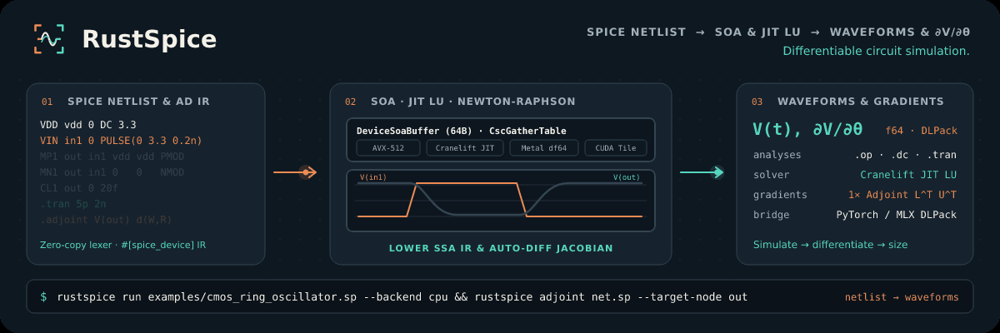

# RustSpice

RustSpice simulates transistor-level SPICE netlists (`.op`, `.dc`, `.tran`) and computes discrete adjoint parameter sensitivities with Structure-of-Arrays (SoA) device evaluation, auto-differentiated model kernels and topology-specialized sparse linear solvers.

[All RustEDA modules](https://lab-emi.github.io/RustEDA/)

<picture>
  <source media="(prefers-reduced-motion: reduce)" srcset="assets/rustspice-banner.svg">
  
</picture>

## Simulate. Differentiate. Size.

Run DC operating point, DC sweep, transient and discrete adjoint sensitivity analysis from standard SPICE decks. All working vectors and sparse matrix structures are pre-compiled once per topology for zero-allocation hot loops.

```sh
rustspice run examples/cmos_ring_oscillator.sp --backend cpu
rustspice adjoint examples/cmos_ring_oscillator.sp --target-node out
rustspice codegen --model mosfet-ekv --target msl
rustspice bench-ngspice --output docs/benchmark_report.md
```

## Head-to-head vs. `ngspice-47`

| Benchmark | Circuit scale | `ngspice-47`<br>end to end ↓ | `RustSpice`<br>end to end ↓ | Speedup ↑ | Max error: `RustSpice` / `ngspice` default ↓ |
| :--- | :--- | ---: | ---: | ---: | ---: |
| **1. Resistor ladder (DC OP)** | 10,000 resistors, 5,002 MNA unknowns (DC operating point) | 56.66 ms | 22.96 ms | **2.47×** | `1.91e-13` / `1.93e-13` V |
| **2. RC line (transient)** | 4,000 R/C elements, `.tran 10p 5n` (500 steps) | 235 ms | 57.36 ms | **4.10×** at 32.8× the error of ngspice default | `5.40e-2` / `1.65e-3` of swing (vs tight ngspice) |
| **3. Diode array (DC sweep)** | 64 diodes + 128 resistors, 201-point DC sweep | 11.83 ms | 7.06 ms | **1.68×** | `5.89e-11` / `5.44e-5` V |
| **4. CMOS inverter chain (transient)** | 200 MOSFETs + 100 capacitors, `.tran 5p 2n` (400 steps) | 78.09 ms | 45.64 ms | **1.71×** | `4.14e-1` / `3.86e-1` of swing (vs tight ngspice) |
| **5. Sensitivity (adjoint vs. ngspice `.sens`)** | 200 resistor gradients (one adjoint solve) | 28.85 ms | 2.26 ms | **12.8×** vs `.sens` | `9.33e-15` / `1.00e-6` (normalised) |
| **6. PVT batch (128 corners)** | 128 PVT corners of a 32-diode nonlinear net (Rayon) | 8.93 ms | 5.77 ms | **1.55×** (parallel workload; **2.44×** via `.dc` sweep) | `2.47e-11` / `1.63e-5` V |

Speedup = `ngspice-47` / `RustSpice`, median of 9 interleaved repetitions against the faster of ngspice's SPARSE 1.3 and KLU solvers; both tools run as subprocesses with rawfile output on tmpfs, the single-core benchmarks pinned to one idle core (the parallel batch, benchmark 6, is not pinned). The previously published 5.3×, 7.6×, 3.0×, 2.6×, 6,285× and 321× came from a harness with known defects (1 ms-quantised solver times, a cold process compared with a warm in-process call, hard-coded zero errors, single runs multiplied by 128 or 400, a transient compared at t = 0 only) and are withdrawn; the report lists each one with its replacement.

## Guides and reference

- [Architecture and crate organization](architecture.md)
- [Benchmark report and methodology](benchmark_report.md)
